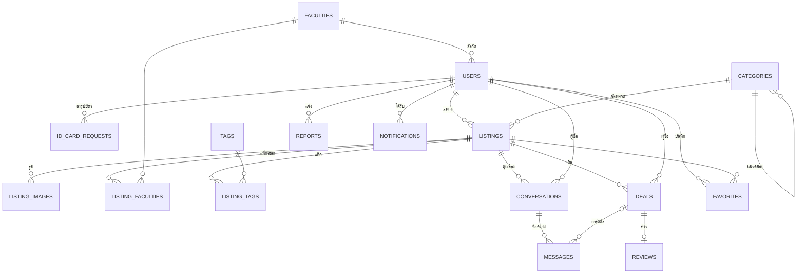

# Campus Market — Database Schema (v2 ฉบับย่อ)

> PostgreSQL 17 · ปรับวันที่ 2026-11-17 · **17 ตาราง** (จากร่างแรก 27) · เขียนเป็น SQL แล้วที่ `backend/migrations/001_init.sql` + `002_seed_reference.sql` (ทดสอบ 47 ข้อกับ PostgreSQL จำลองผ่าน ยังไม่ได้รันกับ PostgreSQL ของเครื่อง)
> v2 ตัดรายละเอียดตามที่ทีมสั่ง: เหลือเท่าที่ระบบทำงานได้และกฎหมายบังคับ

---

## 0. ข้อตกลง

| เรื่อง | ข้อตกลง |
|---|---|
| id | ตารางหลักใช้ `uuid` (`gen_random_uuid()` มีในตัว PostgreSQL 17) ไม่ใช้เลขเรียง เดา/ไล่ดึงข้อมูลไม่ได้ · `messages` กับ `notifications` ใช้ `bigint` เพราะต้องเรียงและดึง `?after=<id>` · ตารางรายการคงที่ (คณะ หมวด แท็ก) ใช้ `smallint` |
| สถานะ | `text` + `CHECK (status IN (...))` |
| เวลา | `timestamptz` default `now()` |
| เงิน | `integer` บาท |
| ลบ | ตารางหลักไม่ลบจริง (ลบบัญชี = ล้างข้อมูลส่วนตัว + `deleted_at`) ตารางลูกใช้ `ON DELETE CASCADE` |
| ไฟล์ | เก็บเป็น `*_key` (ชื่อไฟล์ในโฟลเดอร์ของ server) |
| Extension | `pg_trgm` |

---

## 1. ภาพรวม



| กลุ่ม | ตาราง |
|---|---|
| ผู้ใช้ | `faculties` · `users` · `id_card_requests` |
| สินค้า | `categories` · `tags` · `listings` · `listing_images` · `listing_faculties` · `listing_tags` · `favorites` |
| ซื้อขาย | `conversations` · `messages` · `deals` · `reviews` |
| อื่น ๆ | `reports` · `notifications` · `ad_banners` |

ผู้ขายของแต่ละประกาศคือ `listings.seller_id` ตารางอื่นไม่เก็บซ้ำ (ผู้ขายของดีล / ห้องแชต / รีวิว = ผู้ขายของประกาศ)

---

## 2. ผู้ใช้

### `faculties` (seed 16 แถว เรียงด้วย `id` ตามลำดับทางการ)

| คอลัมน์ | ชนิด | กฎ |
|---|---|---|
| `id` | smallint PK | |
| `name_th` | text | NOT NULL UNIQUE |

### `users` — สมาชิก (ผู้ซื้อ ผู้ขาย และผู้ดูแลอยู่ตารางเดียว)

| คอลัมน์ | ชนิด | กฎ | ความหมาย |
|---|---|---|---|
| `id` | uuid PK | | |
| `email` | text | UNIQUE, NULL | ชื่อล็อกอินของคนนอก (ตัวพิมพ์เล็ก ตรวจรูปแบบอีเมล) · ไม่ยืนยันความเป็นเจ้าของอีเมล (ไม่มีระบบส่งอีเมล) |
| `password_hash` | text | NULL | argon2id จาก `Bun.password` คน สจล. ไม่มี |
| `kmitl_sub` | text | UNIQUE, NULL | `sub` จาก KMITL SSO ของคน สจล. (1 บัญชีสถาบัน = 1 บัญชีเรา) |
| `id_hash` | text | UNIQUE, NULL | HMAC ของเลขบัตร ตั้งตอนผู้ดูแลอนุมัติ กัน 1 คนมีหลายบัญชี (ไม่เก็บเลขจริง) |
| `display_name` | text | NOT NULL, 1–50 ตัว | ชื่อที่ผู้อื่นเห็น |
| `faculty_id` | smallint FK | NULL | คณะ (ใช้จัดหนังสือให้ตรงคณะ) |
| `is_verified` | boolean | default false | ผ่านการยืนยันตัวตนแล้ว (BR01) · ต้องเป็น true ถึงใช้แอปได้ ถ้ายังเป็น false ล็อกอินได้แต่เห็นเฉพาะหน้าสถานะการยืนยัน |
| `is_admin` | boolean | default false | เป็นผู้ดูแล **และยังซื้อขายได้ปกติ** |
| `is_banned` | boolean | default false | ถูกระงับ (BR15) ตรวจทุก request จึงมีผลทันที |
| `deleted_at` | timestamptz | NULL | ลบบัญชีแล้ว |
| `created_at` | timestamptz | | |

- ไม่เก็บชื่อจริง เบอร์ LINE หรือรูปโปรไฟล์ (เก็บเท่าที่จำเป็นตาม PDPA ม.22) · อีเมลเก็บเฉพาะคนนอกเป็นชื่อล็อกอิน · การติดต่อทำในแชต
- **ลบบัญชี:** ตั้ง `deleted_at` + `display_name = 'ผู้ใช้ที่ลบบัญชีแล้ว'` + ล้าง `email` `password_hash` `kmitl_sub` `id_hash` · แถวยังอยู่ให้ดีลและรีวิวเดิมอ้างได้
- ผู้ดูแลตัดสินรายงานเรื่องของตัวเองหรือระงับตัวเองไม่ได้ (ตรวจในโค้ด)

### `id_card_requests` — คำขอยืนยันตัวตนของคนนอก

ลำดับ: **ผู้ใช้อัปโหลด → แถวเป็น `PENDING` → ผู้ดูแลตรวจ → `APPROVED` (`users.is_verified = true` + ตั้ง `id_hash`) หรือ `REJECTED` (ส่งใหม่ได้)**
คน สจล. ไม่ผ่านตารางนี้ ล็อกอินด้วย SSO แล้วเรียก Student API ถ้าสถานะ "เรียน" (หรือเป็นบุคลากร) ตั้ง `is_verified = true` ทันที

| คอลัมน์ | ชนิด | กฎ |
|---|---|---|
| `id` | uuid PK | |
| `user_id` | uuid FK → users | NOT NULL |
| `card_image_key`, `selfie_image_key` | text | NULL เมื่อรูปถูกลบ (เข้ารหัส AES-256-GCM เก็บใน `private/` ลบ 7 วันหลังตัดสิน) |
| `status` | text | `PENDING` \| `APPROVED` \| `REJECTED`, default `PENDING` |
| `reject_reason` | text | NULL |
| `reviewed_by` | uuid FK → users | NULL |
| `created_at` | timestamptz | |

- partial unique `(user_id) WHERE status = 'PENDING'` → รอตรวจได้ทีละคำขอ

---

## 3. สินค้า

### `categories` (seed ต้นไม้หมวด รวมหมวดดิวอี้ของหนังสือ)

| คอลัมน์ | ชนิด | กฎ |
|---|---|---|
| `id` | smallint PK | |
| `parent_id` | smallint FK → categories | NULL = หมวดบนสุด |
| `name_th` | text | NOT NULL เช่น `510 คณิตศาสตร์` |
| `sort` | smallint | default 0 · มีไว้ให้ "อื่น ๆ" อยู่ท้ายเสมอและแทรกหมวดใหม่กลางได้ |

### `tags` (seed)

| คอลัมน์ | ชนิด | กฎ |
|---|---|---|
| `id` | smallint PK | |
| `name_th` | text | NOT NULL UNIQUE เช่น มีกล่อง · มีเฉลย |
| `category_id` | smallint FK | NULL = ใช้ได้ทุกหมวด · มีค่า = ใช้กับหมวดนั้นและลูก |

### `listings` — ประกาศ

| คอลัมน์ | ชนิด | กฎ | ความหมาย |
|---|---|---|---|
| `id` | uuid PK | | |
| `seller_id` | uuid FK → users | NOT NULL | |
| `category_id` | smallint FK → categories | NOT NULL | ต้องเป็นหมวดใบสุดท้าย (ตรวจในโค้ด) |
| `title` | text | 3–100 ตัว | |
| `description` | text | ≤ 2,000 ตัว | **สเปก สภาพ ตำหนิ จำนวนในชุด รหัสวิชา ฯลฯ เขียนที่นี่ทั้งหมด** |
| `price` | integer | `> 0` | บาท (ต่อรองกันนอกระบบ) |
| `status` | text | `AVAILABLE` \| `RESERVED` \| `SOLD` \| `CANCELLED` \| `RETURNED` \| `TAKEN_DOWN`, default `AVAILABLE` | |
| `status_reason` | text | NULL | เหตุผลที่ผู้ดูแลตีกลับ/ถอด (ให้ผู้ขายเห็น) |
| `search_text` | text | NOT NULL default `''` | ชื่อ + รายละเอียด + แท็ก + ชื่อหมวด ที่ตัดคำไทยแล้ว (backend อัปเดตตอนบันทึก) |
| `created_at`, `updated_at` | timestamptz | | |

**Index:** `(status, created_at DESC)` · `(seller_id, status)` · `(category_id)` · `(price)` · GIN `title gin_trgm_ops` · GIN `to_tsvector('simple', search_text)`

ตัวกรองที่เหลือ: หมวด ราคา คณะ แท็ก และคำค้น (ยี่ห้อ รุ่น รหัสวิชา อยู่ในคำค้น)

### ตารางลูก

| ตาราง | คอลัมน์ | กฎ |
|---|---|---|
| `listing_images` | `listing_id` FK (CASCADE) · `position` smallint · `image_key` text | PK `(listing_id, position)` · `position BETWEEN 0 AND 4` (1–5 รูป, 0 = ปก) |
| `listing_faculties` | `listing_id` FK (CASCADE) · `faculty_id` FK | PK ทั้งสองคอลัมน์ · หนังสือต้องมี ≥ 1 แถว (ตรวจในโค้ด) |
| `listing_tags` | `listing_id` FK (CASCADE) · `tag_id` FK | PK ทั้งสองคอลัมน์ · ≤ 5 แท็ก (ตรวจในโค้ด) |
| `favorites` | `user_id` FK (CASCADE) · `listing_id` FK (CASCADE) · `created_at` | PK `(user_id, listing_id)` · index `(listing_id)` ไว้หาคนที่ต้องแจ้งเตือนเมื่อสถานะประกาศเปลี่ยน (CM04) |

---

## 4. ซื้อขาย

### `conversations` — ห้องแชต 1 ห้องต่อ (ประกาศ, ผู้ซื้อ)

แชตเป็นแบบ LINE ธรรมดา: ข้อความตัวอักษร ไม่มีช่องทางติดต่อพิเศษ ผู้ใช้ขอไลน์กันเองในห้อง (เช่น เพื่อวิดีโอคอลดูของก่อนตัดสินใจ) ระบบไม่ห้ามและไม่เกี่ยว

| คอลัมน์ | ชนิด | กฎ |
|---|---|---|
| `id` | uuid PK | |
| `listing_id` | uuid FK → listings | NOT NULL |
| `buyer_id` | uuid FK → users | NOT NULL |
| `created_at` | timestamptz | |

- `UNIQUE (listing_id, buyer_id)` · ทักประกาศของตัวเองไม่ได้ (ตรวจในโค้ด)

### `messages` — ข้อความ (ตัวอักษรอย่างเดียว ไม่มีรูปในแชต)

| คอลัมน์ | ชนิด | กฎ | ความหมาย |
|---|---|---|---|
| `id` | bigint PK | identity | |
| `conversation_id` | uuid FK | NOT NULL | |
| `sender_id` | uuid FK → users | NULL = ข้อความระบบ | |
| `body` | text | 1–1,000 ตัว | |
| `deal_id` | uuid FK → deals | NULL | มีค่า = เป็นการ์ดดีลในแชต (แอปอ่านสถานะล่าสุดจากดีลเสมอ) |
| `client_id` | uuid | NULL | แอปสร้างให้ กันส่งซ้ำตอนเน็ตหลุด |
| `read_at` | timestamptz | NULL | อีกฝ่ายอ่านเมื่อไร (ใช้นับยังไม่อ่านและขึ้น "อ่านแล้ว") |
| `created_at` | timestamptz | | |

- partial unique `(sender_id, client_id) WHERE client_id IS NOT NULL`
- index `(conversation_id, id DESC)`
- นัดรับ = ข้อความธรรมดาในห้อง ไม่มีตารางนัดหมาย

### `deals` — ดีลซื้อขาย (เดิม `purchase_requests`)

| คอลัมน์ | ชนิด | กฎ | ความหมาย |
|---|---|---|---|
| `id` | uuid PK | | |
| `listing_id` | uuid FK → listings | NOT NULL | |
| `buyer_id` | uuid FK → users | NOT NULL | |
| `status` | text | `PENDING` \| `ACCEPTED` \| `HANDED_OVER` \| `COMPLETED` \| `REJECTED` \| `CANCELLED`, default `PENDING` | |
| `meetup` | text | NULL, ≤ 200 ตัว | ที่และเวลานัดรับ เขียนเป็นข้อความ แสดงบนการ์ด |
| `created_at`, `updated_at` | timestamptz | | `updated_at` ใช้นับ 48 ชม. ของการยืนยันอัตโนมัติ |
| `completed_at` | timestamptz | NULL | ใช้กราฟยอดขายรายเดือน |

- partial unique `(listing_id) WHERE status IN ('ACCEPTED','HANDED_OVER')` → **จองได้คนเดียว** (BR09)
- partial unique `(listing_id) WHERE status = 'COMPLETED'` → ขายได้ครั้งเดียว
- partial unique `(listing_id, buyer_id) WHERE status = 'PENDING'` → ข้อเสนอค้างได้คนละ 1
- index `(buyer_id, status)`, `(listing_id, status)`

```
PENDING ──ผู้ขายตกลง──▶ ACCEPTED ──ผู้ขาย "ส่งมอบแล้ว"──▶ HANDED_OVER ──ผู้ซื้อ "ได้รับแล้ว" หรือครบ 48 ชม.──▶ COMPLETED
   ├─ผู้ขายปฏิเสธ / มีคนอื่นถูกตกลง──▶ REJECTED
   └─ผู้ซื้อถอน / ประกาศถูกยกเลิก──▶ CANCELLED ◀── ACCEPTED (ประกาศกลับ AVAILABLE)
```

### `reviews` — ผู้ซื้อรีวิวผู้ขาย

| คอลัมน์ | ชนิด | กฎ |
|---|---|---|
| `id` | uuid PK | |
| `deal_id` | uuid FK → deals | UNIQUE · ดีลต้อง `COMPLETED` (ตรวจในโค้ด) |
| `rating` | smallint | `BETWEEN 1 AND 5` |
| `comment` | text | NULL, ≤ 300 ตัว |
| `created_at` | timestamptz | |

ผู้รีวิวและผู้ถูกรีวิวหาได้จากดีล → ไม่เก็บซ้ำ · คะแนนเฉลี่ยและจำนวนดีลสำเร็จคำนวณตอน query

---

## 5. อื่น ๆ

### `reports` — รายงาน

| คอลัมน์ | ชนิด | กฎ |
|---|---|---|
| `id` | uuid PK | |
| `reporter_id` | uuid FK → users | NOT NULL |
| `target_type` | text | `LISTING` \| `USER` \| `MESSAGE` |
| `target_id` | text | NOT NULL (uuid หรือเลขข้อความ ตรวจว่ามีจริงในโค้ด) |
| `reason` | text | NOT NULL เลือกจากรายการในแอป |
| `detail` | text | NULL, ≤ 300 ตัว |
| `snapshot` | jsonb | NULL สำเนาเป้าหมาย ณ เวลารายงาน (ประกาศ / ข้อความ + 5 ข้อความรอบข้าง) กันถูกแก้หรือลบ |
| `status` | text | `OPEN` \| `CLOSED`, default `OPEN` |
| `admin_note` | text | NULL บังคับเมื่อปิด (บอกว่าทำอะไรไป) |
| `resolved_by` | uuid FK → users | NULL |
| `created_at` | timestamptz | |

- `UNIQUE (target_type, target_id, reporter_id)` · index `(status, created_at)`
- ผลของการตัดสิน (ตีกลับ ถอด ระงับ) ไปเปลี่ยนที่ `listings.status` / `users.is_banned` โดยตรง

### `notifications` (ไม่รวมข้อความแชต — ดูข้อ 6)

| คอลัมน์ | ชนิด | กฎ |
|---|---|---|
| `id` | bigint PK | identity |
| `user_id` | uuid FK → users | NOT NULL |
| `type` | text | NOT NULL เช่น `NEW_OFFER` `DEAL_ACCEPTED` `HANDED_OVER` `LISTING_RETURNED` `REVIEWED` `VERIFY_RESULT` `FAVORITE_STATUS` `DEAL_NUDGE` `REVIEW_PROMPT` |
| `body` | text | NOT NULL |
| `ref_id` | text | NULL ดีล/ประกาศที่แตะแล้วเปิดไป |
| `is_read` | boolean | default false |
| `created_at` | timestamptz | |

- index `(user_id, id DESC)` ให้ `NotificationWorker` ดึง `?after=<id>`

### `ad_banners`

| คอลัมน์ | ชนิด | กฎ |
|---|---|---|
| `id` | smallint PK | |
| `title` | text | NOT NULL (ชื่อให้ผู้ดูแลจำ ไม่แสดงผู้ใช้) |
| `image_key` | text | NOT NULL รูป 2:1 |
| `link_url` | text | NULL ขึ้นต้น `https://` หรือ `campusmarket://` |
| `starts_at`, `ends_at` | timestamptz | `CHECK (ends_at > starts_at)` |
| `is_active` | boolean | default true |
| `sort` | smallint | default 100 |

---

## 6. สิ่งที่ตัดออกจากร่างแรก และผลที่ตามมา

| ตัดออก | แทนด้วย | ผลที่ต้องรู้ |
|---|---|---|
| `user_identities` | `users.kmitl_sub` + `users.id_hash` | |
| `sessions` | JWT อายุ 7 วัน ไม่มี refresh | ออกจากระบบ = แอปลบ token · token ที่หลุดใช้ได้จนหมดอายุ แต่ **ระงับผู้ใช้มีผลทันที** เพราะตรวจ `is_banned` ทุก request |
| `oidc_states`, `auth_codes` | เก็บในหน่วยความจำของ server (หมดอายุเอง 10 นาที / 60 วินาที) | server รีสตาร์ทระหว่างที่ผู้ใช้กำลังล็อกอินอยู่ = ต้องกดใหม่ ใช้ได้เพราะรัน server เดียว |
| `listing_status_history` | — | ดูไม่ได้ว่าใครเปลี่ยนสถานะเมื่อไร |
| `meetups` | `deals.meetup` (ข้อความ) | ไม่มีแจ้งเตือนก่อนนัด เพราะเวลาเป็นข้อความอิสระ |
| `blocks` | รายงาน + ผู้ดูแลระงับ | ผู้ใช้บล็อกคนกวนเองไม่ได้ |
| `privacy_requests` | endpoint ทำทันที: ส่งออกข้อมูล + ลบบัญชี (แก้/คัดค้านใช้การติดต่อผู้ดูแล) | ไม่มีการติดตามกำหนด 30 วัน |
| `admin_audit_logs`, `access_logs` | **ไฟล์ log** หมุนรายวัน เก็บ 90 วัน (ไม่ใช่ตาราง) | `access_logs` ยังทำตาม พ.ร.บ.คอมพิวเตอร์ ม.26 ได้ ต้องไม่เขียนรหัสผ่าน/token ลงไฟล์ · audit ของผู้ดูแล (เปิดดูรูปบัตร) อยู่ในไฟล์เดียวกัน |
| `purchase_requests.offered/agreed_price` | — | ยอดขายใน Dashboard = **ผลรวมราคาประกาศ** ของประกาศที่ขายแล้ว เป็นค่าประมาณ ราคาที่ต่อรองจริงอยู่นอกระบบ |
| `listings.condition`, `defect_note`, `set_size`, `negotiable`, `attributes` | `description` | **กรองตามสภาพ ยี่ห้อ RAM ไม่ได้** เหลือกรองตามหมวด ราคา คณะ แท็ก และคำค้น |
| `users.line_id`, `phone`, `real_name` | การติดต่อในแชต | ไม่มีกฎ "เปิดช่องทางติดต่อเมื่อรับคำขอ" |
| `users.personalize`, `flagged`, `show_faculty`, `photo_key` | — | |
| `messages`: `kind`, `image_key`, `event`, `has_risk_warning`, `deleted_at` | — | แชตเป็นตัวอักษรอย่างเดียว ไม่มีรูป · แถบเตือนห้ามโอนเงินแสดงถาวรในห้อง ไม่ตรวจเนื้อหา |
| `deals`: `is_retroactive`, `auto_completed`, `*_at` ส่วนใหญ่ | — | **ตัดฟีเจอร์ "ขายนอกระบบแล้วบันทึกย้อนหลัง"** (ผมเพิ่มเอง เปิดช่องปั้นยอดขายและรีวิว) ขายนอกระบบก็แค่ยกเลิกประกาศ |

---

## 7. ที่ฐานข้อมูลบังคับเอง และที่ต้องตรวจในโค้ด

**ฐานข้อมูลบังคับ:** จองได้คนเดียว · ขายได้ครั้งเดียว · ข้อเสนอค้างคนละ 1 · ห้องแชตซ้ำไม่ได้ · ส่งข้อความซ้ำไม่ได้ · รีวิว 1 ดีลครั้งเดียว · รายงานซ้ำไม่ได้ · ชื่อล็อกอิน/sub/เลขบัตรซ้ำไม่ได้ · ราคา > 0 · คะแนน 1–5 · ค่าสถานะทุกตัว

**ต้องตรวจในโค้ด (และมีเทสต์):** หมวดต้องเป็นใบสุดท้าย · หนังสือมีแท็กคณะ ≥ 1 · แท็ก ≤ 5 · ผู้ซื้อ ≠ ผู้ขาย · ผู้ส่งข้อความอยู่ในห้อง · ตารางการเปลี่ยนสถานะ · ผู้ดูแลตัดสินเรื่องของตัวเองไม่ได้ · `target_id` ของรายงานมีอยู่จริง

## 8. จุดที่ต้องทำใน transaction เดียว

| เหตุการณ์ | ขั้นตอน |
|---|---|
| **ผู้ขายตกลงดีล** | ล็อกประกาศ `FOR UPDATE` → ต้อง `AVAILABLE` ไม่งั้น 409 → ดีลเป็น `ACCEPTED` → ประกาศ `RESERVED` → ดีล `PENDING` อื่นเป็น `REJECTED` → ข้อความระบบ + แจ้งเตือน (รวมคนที่บันทึกประกาศนี้ไว้ `FAVORITE_STATUS`) |
| **ผู้ซื้อกดได้รับแล้ว (หรืองานยืนยันอัตโนมัติ)** | ล็อกดีล → ต้อง `HANDED_OVER` → `COMPLETED` + `completed_at` → ประกาศ `SOLD` → ข้อความระบบ + แจ้งเตือน (ผู้ขาย + ชวนผู้ซื้อรีวิว `REVIEW_PROMPT` + คนที่บันทึกประกาศไว้) |
| **ผู้ขายยกเลิกประกาศ** | ล็อกประกาศ → ต้อง `AVAILABLE` → `CANCELLED` → ดีล `PENDING` เป็น `CANCELLED` + แจ้งเตือน |
| **ส่งข้อความ** | `INSERT … ON CONFLICT (sender_id, client_id) DO NOTHING` |

**งานเบื้องหลังที่ server (ทุก 15 นาที ยกเว้นระบุไว้):** ยืนยันดีล `HANDED_OVER` ที่เกิน 48 ชม. (ข้ามดีลที่มีรายงานค้าง) · เตือนช่วยปิดดีล (ข้อ 10) · ลบรูปบัตรที่ครบ 7 วันหลังตัดสิน (วันละครั้ง) · ลบไฟล์ log เกิน 90 วัน (วันละครั้ง)

**แชตกับแจ้งเตือน:** ข้อความใหม่ไม่สร้างแถวใน `notifications` จำนวนที่ยังไม่อ่านนับจาก `messages.read_at IS NULL` แอปดึงรายการห้อง (`/conversations`) พร้อมแจ้งเตือนปกติ แล้วเด้งการแจ้งเตือนของระบบ

## 9. ตัวชี้วัดความสำเร็จของผู้ขาย (คำนวณตอน query ไม่ต้องมีคอลัมน์เพิ่ม)

เป้าหมายของระบบคือให้ **ดีลปิดสำเร็จในระบบให้มากที่สุด** → มีรีวิวมาก → ผู้ขายน่าเชื่อถือ → คนลงขายถี่ขึ้น → มีของและผู้เข้าชมมากขึ้น → โฆษณามีค่าขึ้น (รายได้มาจากโฆษณาอย่างเดียว ไม่หักค่าธรรมเนียมจากการขาย)

| ตัวเลขบนโปรไฟล์ผู้ขาย | วิธีนับ |
|---|---|
| ปิดการขายสำเร็จ | จำนวนประกาศของผู้ขายที่ `SOLD` |
| **อัตราปิดการขาย** | `SOLD ÷ (SOLD + CANCELLED)` แสดงเฉพาะเมื่อปิดแล้ว ≥ 3 ประกาศ ไม่ถึงแสดง "ผู้ขายใหม่" (กัน 1 จาก 1 = 100% ดูเก่งเกินจริง) |
| ดีลสำเร็จ | จำนวนดีล `COMPLETED` |
| คะแนนรีวิว | ค่าเฉลี่ย **นับผู้ซื้อแต่ละคนครั้งเดียว** (ซื้อซ้ำจากผู้ขายคนเดิมไม่ดันคะแนน) |
| ผู้ซื้อที่ไม่ซ้ำกัน | จำนวนผู้ซื้อต่างคนของดีลที่สำเร็จ |

**กันการปั่นตัวเลข** (ให้ตัวเลขสะท้อนการขายจริง ถ้าปลอมได้ ผู้ซื้อจะเลิกเชื่อและระบบเสียค่าที่สุดไป)
- `SOLD` เกิดจากดีล `COMPLETED` เท่านั้น ผู้ขายกด "ขายแล้ว" เองไม่ได้
- รีวิวได้เฉพาะผู้ซื้อของดีลที่สำเร็จ ดีลละครั้ง
- 1 ตัวตน = 1 บัญชี (`kmitl_sub` / `id_hash` ห้ามซ้ำ) สร้างบัญชีปลอมมาซื้อเองไม่ได้ง่าย
- ผู้ดูแลมีมุมมองคู่ซื้อ–ขายซ้ำ (ผู้ซื้อคนเดียวซื้อจากผู้ขายคนเดียวหลายครั้ง) ไว้ตรวจเมื่อมีรายงาน (query ไม่ต้องมีตาราง)
- ความเสี่ยงที่ยังเหลือ: เพื่อนสองคนจริง ๆ ช่วยกันปั่น ป้องกันได้แค่บางส่วนด้วยกฎ "ผู้ซื้อคนเดียวนับครั้งเดียว"

## 10. ทำให้ปิดดีลในระบบง่ายกว่าขายนอกระบบ

ห้ามขายนอกระบบไม่ได้ (เงินเปลี่ยนมือตอนเจอกัน) จึงทำให้ในระบบ **ง่ายกว่าและได้ประโยชน์กว่า**

| ทำอะไร | ตอนนี้ต้องเพิ่มอะไรใน schema |
|---|---|
| ปิดดีลด้วยการกดการ์ดในแชต ผู้ขาย 1 ครั้ง (ส่งมอบ) ผู้ซื้อ 1 ครั้ง (ได้รับ) หรือครบ 48 ชม.ยืนยันเอง | ไม่ต้อง |
| **เตือนช่วยปิดดีล:** ดีล `ACCEPTED` เกิน 24 ชม. → แจ้งทั้งสองฝ่าย "นัดเจอกันแล้วหรือยัง? กดส่งมอบในการ์ด" · `HANDED_OVER` เกิน 24 ชม. → แจ้งผู้ซื้อ · ดีลสำเร็จ → ชวนรีวิวทันที และเตือนซ้ำ 1 ครั้งหลัง 3 วันถ้ายังไม่รีวิว | ไม่ต้อง ส่งครั้งเดียวต่อดีลด้วย `NOT EXISTS (SELECT 1 FROM notifications WHERE type = … AND ref_id = …)` |
| ประโยชน์เฉพาะดีลในระบบ: รีวิว ตัวเลข "ปิดการขายสำเร็จ" และอัตราปิดการขายบนโปรไฟล์ | ไม่ต้อง |
| ผู้ขายยกเลิกประกาศ ระบบถามเหตุผลสั้น ๆ ("ขายได้แล้วที่อื่น" / "เปลี่ยนใจ" / "ของเสีย") ไว้ดูภาพรวมว่ารั่วนอกระบบเท่าไร | เก็บเป็นข้อความใน `listings.status_reason` ได้เลย |

ถ้าภายหลังอยากเรียงผลค้นหาให้ผู้ขายที่อัตราปิดสูงขึ้นก่อน ทำได้ด้วย query โดยไม่ต้องแก้ตาราง แต่ผมแนะนำให้เป็น "ตัวเลือกเรียง" ไม่ใช่บังคับ เพราะผู้ขายใหม่จะไม่มีโอกาสถูกเห็น

## 11. ที่ยังเปิดอยู่

1. สร้างฐานข้อมูลบนเครื่อง แล้วรัน `bun migrate` และตรวจ `pg_trgm` กับอักษรไทยใน locale ของฐานข้อมูลนั้น
2. ยอดผู้เข้าชม/การแสดงผลโฆษณา (impression) ยังไม่มี ถ้าวันหน้าต้องโชว์ผู้ลงโฆษณาว่าได้ผลเท่าไร ต้องเพิ่มตารางสถิติรายวัน (Phase 14)
