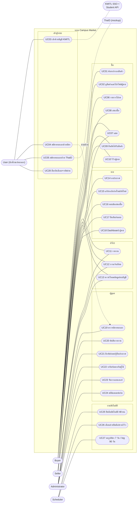
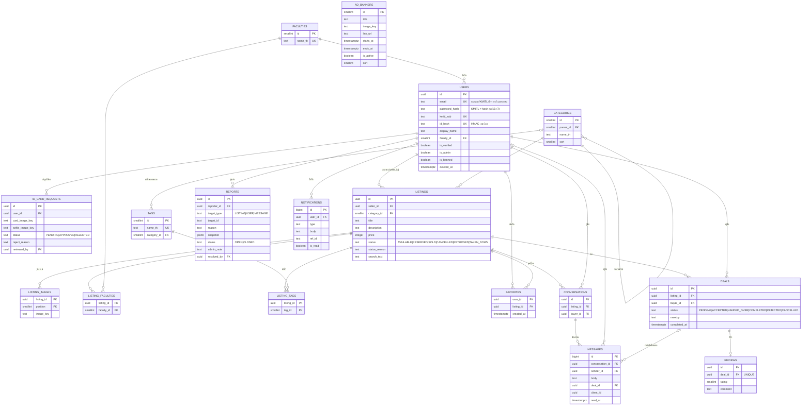

# Campus Market — สรุปโครงงาน

> สรุปจากระบบที่สร้างและทดสอบแล้วจริง (Android + Backend + PostgreSQL) ไม่ใช่จากแผนอย่างเดียว
> รายละเอียดเต็มอยู่ที่ [PROJECT_PLAN.md](PROJECT_PLAN.md) · [DB_SCHEMA.md](DB_SCHEMA.md) · [WORKFLOWS.md](WORKFLOWS.md) · [TEST_CASES.md](TEST_CASES.md)
> สถานะ: เป็น **proof of concept** — ฟังก์ชันครบตามขอบเขตและทดสอบอัตโนมัติผ่าน แต่ยังไม่ใช่ระบบ production

---

## 1. ที่มาและปัญหาที่ต้องการแก้ไข

**ที่มา** นักศึกษามีของมือสองที่ใช้เสร็จแล้วเป็นประจำ เช่น หนังสือเรียน อุปกรณ์คอมพิวเตอร์ เครื่องเขียน ส่วนนักศึกษารุ่นถัดไปต้องการของเหล่านี้ในราคาถูก ปัจจุบันการซื้อขายเกิดตามกลุ่มแชตและโพสต์ในโซเชียลมีเดียทั่วไป

**ปัญหา**

| ปัญหา | ผลที่เกิด |
|---|---|
| ประกาศกระจายหลายกลุ่ม ค้นหาและกรองยาก (ตามหมวด คณะ ราคา) | หาของที่ต้องการไม่เจอ ประกาศจมหาย |
| ไม่รู้ว่าอีกฝ่ายเป็นคนในสถาบันจริงหรือไม่ | เสี่ยงถูกหลอก นัดรับไม่ปลอดภัย |
| ไม่มีสถานะสินค้าที่เชื่อถือได้ (ว่าง / ถูกจอง / ขายแล้ว) | ถามซ้ำ จองซ้อน ขายซ้ำ |
| ไม่มีประวัติความน่าเชื่อถือของผู้ขาย | ตัดสินใจจากความรู้สึก |
| ไม่มีช่องทางรายงานประกาศหลอกลวงและไม่มีผู้ดูแลที่ชัดเจน | ปัญหาไม่ถูกแก้ |

**แนวทางแก้ (สิ่งที่ระบบทำ)** กระดานซื้อขายภายในสถาบัน: ยืนยันตัวตนก่อนใช้งาน ค้นหา/กรองได้ในที่เดียว มีสถานะสินค้าที่ระบบบังคับ (จองได้คนเดียว) แชตและเสนอซื้อในแอป ผู้ซื้อกดรับของเพื่อปิดดีลแล้วรีวิวผู้ขาย มีระบบรายงานและผู้ดูแล

**ขอบเขต** ระบบ **ไม่เกี่ยวกับการชำระเงิน** (จ่ายกันเองตอนนัดรับ) · ไม่มีค่าธรรมเนียมการขาย · รายได้ของแพลตฟอร์มมาจากแบนเนอร์โฆษณาเท่านั้น

---

## 2. วัตถุประสงค์และกลุ่มผู้ใช้งาน

### 2.1 วัตถุประสงค์

1. ให้ผู้ใช้ลงประกาศ ค้นหา และซื้อขายสินค้ามือสองภายในชุมชนสถาบันได้ครบวงจรในแอปเดียว
2. สร้างความเชื่อถือ: ยืนยันตัวตนทุกคนก่อนใช้งาน มีรีวิวจากดีลที่สำเร็จจริง และระบบรายงาน
3. **ให้ปิดดีลสำเร็จในระบบมากที่สุด** เพราะรีวิวสะสม → ผู้ขายน่าเชื่อถือ → คนลงขายถี่ขึ้น → แบนเนอร์โฆษณามีค่า
4. เก็บข้อมูลส่วนบุคคลน้อยที่สุดและเป็นไปตามหลัก PDPA (ดาวน์โหลดข้อมูล ลบบัญชี ประกาศความเป็นส่วนตัว)
5. เป็นงานตามรายวิชาที่ใช้ Android (Kotlin/Compose, Room, Retrofit, WorkManager, CameraX) กับ backend จริง

### 2.2 กลุ่มผู้ใช้งาน

| กลุ่ม | คือใคร | วิธีเข้าระบบ |
|---|---|---|
| **ผู้ซื้อ (Buyer)** | สมาชิกที่หาซื้อสินค้า | — |
| **ผู้ขาย (Seller)** | สมาชิกที่ลงประกาศขาย | — |
| **ผู้ดูแล (Administrator)** | สมาชิกที่มีสิทธิ์ `is_admin` ตรวจตัวตน จัดการรายงาน ระงับผู้ใช้ จัดการแบนเนอร์ ดูสถิติ | สร้างที่ฐานข้อมูลด้วยสคริปต์เท่านั้น (ไม่มีหน้าแต่งตั้งในแอป โดยตั้งใจ) |
| นักศึกษา/บุคลากร สจล. | สมาชิกที่เข้าด้วยบัญชีสถาบัน | KMITL SSO + Student API (ตอนนี้ใช้ **ตัวจำลอง** เพราะต่อของจริงไม่ได้) |
| บุคคลภายนอก | สมาชิกที่ไม่ใช่คนใน สจล. อายุ 20 ปีขึ้นไป | สมัครด้วยอีเมล + รหัสผ่าน แล้วยืนยันด้วยบัตรประชาชน (ผู้ดูแลตรวจ) หรือ ThaID (mockup) |
| ระบบภายนอก | KMITL SSO, Student API, ThaID (mockup) | — |
| ตัวตั้งเวลา (Scheduler) | งานเบื้องหลังของเซิร์ฟเวอร์ | — |

บัญชีเดียวเป็นได้ทั้งผู้ซื้อและผู้ขาย · ผู้ดูแลก็ซื้อขายได้ · ไม่มีโหมดผู้เยี่ยมชม (ต้องล็อกอินและผ่านการยืนยันก่อนใช้งาน)

### 2.3 โมเดลรายได้

แบนเนอร์โฆษณา Carousel บนหน้าแรกแบบเดียว ผู้ดูแลเป็นคนเพิ่มให้ผู้ลงโฆษณา (ร้านรอบสถาบัน แบรนด์ หน่วยงาน) ไม่ต้องมีบัญชี · ป้าย "โฆษณา" ทุกใบ · ไม่มีราคาหรือการเล็งเป้าผู้ใช้ · ยังไม่นับยอดแสดงผล

---

## 3. Functional Requirements และ Business Rules

### 3.1 Functional Requirements

**จากโจทย์ (CM)**

| รหัส | ความต้องการ | สิ่งที่ระบบทำจริง |
|---|---|---|
| CM01 | สมัครสมาชิกและสร้างโปรไฟล์ | KMITL SSO / สมัครคนนอก (อีเมล+รหัสผ่าน) · โปรไฟล์ = ชื่อที่แสดง + คณะ แก้ได้ |
| CM02 | ประกาศสินค้าพร้อมรูป ราคา รายละเอียด | ฟอร์มเดียวทุกหมวด รูป 1–5 (ถ่ายหรือเลือกจากคลัง) มีแบบร่างในเครื่อง (Room) |
| CM03 | ค้นหา กรอง เรียงลำดับ | ค้นข้อความภาษาไทย (ตัดคำ) · กรองหมวด ราคา คณะ แท็ก · เรียงลำดับ |
| CM04 | รายการโปรด | บันทึก/เอาออก · ขายแล้วยังเห็น · แจ้งเตือนเมื่อสถานะเปลี่ยน |
| CM05 | ติดต่อผู้ขาย / ส่งคำขอซื้อ | แชตเรียลไทม์ (WebSocket) + การ์ดเสนอซื้อในห้องแชต |
| CM06 | ติดตามสถานะสินค้า | 6 สถานะประกาศ · 6 สถานะดีล · ผู้ขายส่งมอบ ผู้ซื้อกดรับ (48 ชม. ระบบปิดให้) |
| CM07 | แจ้งเตือน | ตาราง `notifications` + WorkManager ดึงแล้วเด้งในเครื่อง · แชตนับจากข้อความที่ยังไม่อ่าน |
| CM08 | รีวิวผู้ขาย | ผู้ซื้อของดีลที่สำเร็จ ดีลละครั้ง 1–5 ดาว |
| CM09 | รายงานประกาศผิดกฎ/หลอกลวง | รายงานประกาศ ผู้ใช้ ข้อความ · คิวผู้ดูแล · ตีกลับ/ถอด/ระงับ |
| CM10 | Dashboard | สถิติของฉัน (ผู้ขาย/ผู้ซื้อ กราฟยอดรายเดือน) · สถิติรวมแพลตฟอร์ม (ผู้ดูแล) |

**ที่ทีมเพิ่ม (EX)**

| รหัส | ความต้องการ | สิ่งที่ระบบทำจริง |
|---|---|---|
| EX01 | ยืนยันตัวตนก่อนซื้อขาย | SSO (6 สถานภาพที่ผ่าน) · ถ่ายบัตร+เซลฟี ผู้ดูแลตรวจ (รูปเข้ารหัส ลบ 7 วัน) · ThaID mockup |
| EX02 | แบนเนอร์โฆษณา | Carousel หน้าแรก 2:1 · หน้าผู้ดูแลเพิ่ม/แก้/เปิดปิด/กำหนดช่วงวัน |
| EX03 | ความเป็นส่วนตัว | ประกาศความเป็นส่วนตัว · ดาวน์โหลดข้อมูล JSON · ลบบัญชี |
| EX04 | แชตต่อประกาศ | ห้องละ (ประกาศ, ผู้ซื้อ) ส่งข้อความรอส่งตอนออฟไลน์ได้ |

**ที่ไม่ได้ทำ (ตัดสินใจแล้ว)** การชำระเงินจริง · ประกาศรับซื้อ · ปุ่มดันประกาศ · บล็อกผู้ใช้ · รูปในแชต · FCM · นับยอดแสดงผลโฆษณา · ThaID จริง · หลายชิ้นต่อประกาศ · แถบ "หนังสือสำหรับคณะของคุณ" บนหน้าแรก · แต่งตั้งผู้ดูแลผ่านแอป · ทดสอบหลายผู้ใช้พร้อมกันเป็นชุด

**ข้อจำกัดของสิ่งที่ทำ** SSO/Student API จริงยังต่อไม่ได้ (Client not found / unauthorized) จึงใช้ตัวจำลองที่ flow เดียวกัน · ถ่ายรูปด้วยกล้องจริงทดสอบไม่ได้บนอีมูเลเตอร์ (ทดสอบผ่านคลังภาพ)

### 3.2 Business Rules

บังคับที่ backend ทุกข้อ (บางข้อซ้ำที่ฐานข้อมูล) แอปตรวจซ้ำเพื่อ UX เท่านั้น

**บัญชีและการยืนยันตัวตน**

| # | กฎ |
|---|---|
| BR01 | ต้องล็อกอินและ `is_verified` ก่อนใช้ฟีเจอร์ทั้งหมด · ยังไม่ยืนยันเห็นเฉพาะหน้าสถานะ |
| BR02 | คน สจล. ผ่านเมื่อสถานภาพ = เรียน · เปลี่ยนหลักสูตร · รออนุมัติสำเร็จการศึกษา · โอนย้ายข้ามคณะ · ครบหลักสูตร (ค้างชำระ) · เรียนเกินหลักสูตร · ชื่อที่แสดงตั้งต้น = ชื่อ+นามสกุลไทย · คนนอกต้องอายุ 20+ |
| BR03 | 1 ตัวตน = 1 บัญชี (`kmitl_sub`, `id_hash` ห้ามซ้ำ) |
| BR15 | ผู้ใช้ถูกระงับ: ใช้งานไม่ได้ทันที · ประกาศซ่อนจากการค้นหา · ดีลค้างถูกยกเลิก |
| BR17 | ทุก endpoint ต้องมี JWT และ `is_verified` ยกเว้น `/auth/*` และส่ง/ดูสถานะบัตรของตัวเอง |

**ประกาศ**

| # | กฎ |
|---|---|
| BR04 | ชื่อ 3–100 ตัว · ราคา > 0 · หมวดใบสุดท้าย · รูป 1–5 · รายละเอียด ≤ 2,000 · หนังสือต้องมีแท็กคณะ ≥ 1 · แท็ก ≤ 5 |
| BR05 | แก้/ยกเลิกได้เฉพาะเจ้าของ (ผู้ดูแลตีกลับหรือถอดได้) |
| BR16 | ผลค้นหาแสดงเฉพาะ "กำลังขาย" และ "ถูกจอง" |
| BR22 | ผู้ขายยกเลิกได้เฉพาะตอน "กำลังขาย" · ถามเหตุผล |
| BR23 | ผู้ดูแลตีกลับ/ถอดต้องมีเหตุผล · ดีลค้างถูกยกเลิกและแจ้งเตือน |
| BR24 | "ขายแล้ว" เกิดจากดีลสำเร็จเท่านั้น เป็นสถานะสุดท้าย |

**แชตและดีล**

| # | กฎ |
|---|---|
| BR06 | ทักแชต/เสนอซื้อประกาศตัวเองไม่ได้ |
| BR07–08 | เสนอซื้อได้เฉพาะ "กำลังขาย" · ผู้ซื้อมีข้อเสนอรอตอบได้ 1 รายการต่อประกาศ |
| BR09 | **จองได้คนเดียว** (transaction + ล็อกแถว + unique index) · ข้อเสนออื่นถูกปฏิเสธอัตโนมัติ |
| BR10 | เปลี่ยนสถานะได้เฉพาะผู้มีสิทธิ์และตามลำดับ |
| BR11 | ผู้ขายกด "ส่งมอบแล้ว" → ผู้ซื้อกด "ได้รับแล้ว" · ไม่กดใน 48 ชม. ระบบปิดให้ (ข้ามดีลที่มีรายงานค้าง) |
| BR25–28 | แชต 1 ห้องต่อ (ประกาศ, ผู้ซื้อ) · เฉพาะสองฝ่าย (ผู้ดูแลเห็นเฉพาะข้อความที่ถูกรายงาน) · ข้อความ ≤ 1,000 ตัว ≤ 30 ข้อความ/นาที · ข้อความแชตไม่ลงตารางแจ้งเตือน |

**รีวิว รายงาน ผู้ดูแล**

| # | กฎ |
|---|---|
| BR12 | รีวิวได้เฉพาะผู้ซื้อของดีลที่สำเร็จ ดีลละครั้ง 1–5 ดาว ≤ 300 ตัว |
| BR13 | รายงานเป้าหมายเดิมได้คนละครั้ง ต้องมีเหตุผล รายงานตัวเองไม่ได้ |
| BR14 | เฉพาะผู้ดูแลปิดรายงาน/ตีกลับ/ถอด/ระงับ/ตรวจตัวตน/จัดการแบนเนอร์ · ต้องมีหมายเหตุ · ตัดสินเรื่องตัวเองหรือระงับตัวเอง/ผู้ดูแลด้วยกันไม่ได้ |
| BR18 | แบนเนอร์แสดงเมื่อเปิดและอยู่ในช่วงวัน ≤ 6 ใบ · ลิงก์ `https://` หรือ `campusmarket://` เท่านั้น · รูป 2:1 (±5%) กว้าง ≥ 600 px ≤ 2 MB |

**ความเป็นส่วนตัวและ log**

| # | กฎ |
|---|---|
| BR19 | รูปบัตร/เซลฟีเข้ารหัส เก็บแยก ลบ 7 วันหลังตัดสิน · ผู้ดูแลเปิดดูทุกครั้งถูกบันทึก |
| BR20 | ไฟล์ log การเข้าใช้เก็บ 90 วันแล้วลบ · ห้ามเขียนรหัสผ่าน/token/เลขบัตร |
| BR21 | ดาวน์โหลดข้อมูลได้ทันที · คำร้องแก้ไข/คัดค้านตอบใน 30 วัน · ลบบัญชีไม่ได้ถ้ามีดีลค้าง · ลบแบบล้างข้อมูลระบุตัวตน |

---

## 4. Use Case Diagram และ ER Diagram

### 4.1 Use Case Diagram

Actor: **Buyer, Seller, Administrator** ต่างเป็นชนิดของ **User** (บัญชีเดียวเป็นได้หลายบทบาท) · ระบบภายนอก: KMITL SSO + Student API, ThaID (mockup) · **Scheduler** คืองานเบื้องหลัง

**หมายเหตุการอ่าน** Administrator ซื้อขายได้เหมือน User ทั่วไป (เชื่อมกับ UC ฝั่ง Buyer/Seller ได้ แต่ไม่วาดซ้ำเพื่อลดเส้น) · ทุก UC ยกเว้น UC03–UC05 และ UC28 ต้องล็อกอินและผ่านการยืนยันแล้ว (BR01)

### 4.2 ER Diagram

17 ตาราง (สร้างจาก `backend/migrations/001_init.sql` จริง) · ผู้ขายของดีล/ห้องแชต/รีวิว = `listings.seller_id` ไม่เก็บซ้ำ

`AD_BANNERS` ไม่มีความสัมพันธ์กับตารางอื่น (ผู้ดูแลเพิ่มให้ผู้ลงโฆษณาภายนอก) · ข้อจำกัดสำคัญระดับฐานข้อมูล: จองได้คนเดียวต่อประกาศ (partial unique บน `deals`) · ขายได้ครั้งเดียว · ข้อเสนอค้างได้คนละ 1 · รีวิวดีลละ 1 · ส่งข้อความซ้ำไม่ได้ (`client_id`)

---

## 5. ผลการทดสอบและสถานะ

| ด้าน | ผล |
|---|---|
| Backend | 242 เทสต์อัตโนมัติผ่าน (bun test กับ PostgreSQL จริง แยกฐานทดสอบ) |
| Android | Unit test ผ่าน · ทดสอบ flow จริงบนอีมูเลเตอร์ (MuMu) ผ่าน adb |
| Flow หลัก | ล็อกอิน → ลงประกาศ → ค้นหา → แชต → เสนอซื้อ → ตกลง → ส่งมอบ → รับของ → รีวิว ผ่าน |
| ยังไม่ได้ทดสอบ | SSO/Student API จริง · กล้องถ่ายภาพนิ่งจริง · หลายผู้ใช้พร้อมกัน · การแจ้งเตือนระบบจากตัวทำงานเบื้องหลังบนเครื่องจริง |

วิธีทดสอบด้วยมือ [MANUAL_TEST_GUIDE.md](MANUAL_TEST_GUIDE.md) · ตาราง Test Case [TEST_CASES.md](TEST_CASES.md) · บัญชีทดสอบ [SEED_ACCOUNTS.md](SEED_ACCOUNTS.md)
