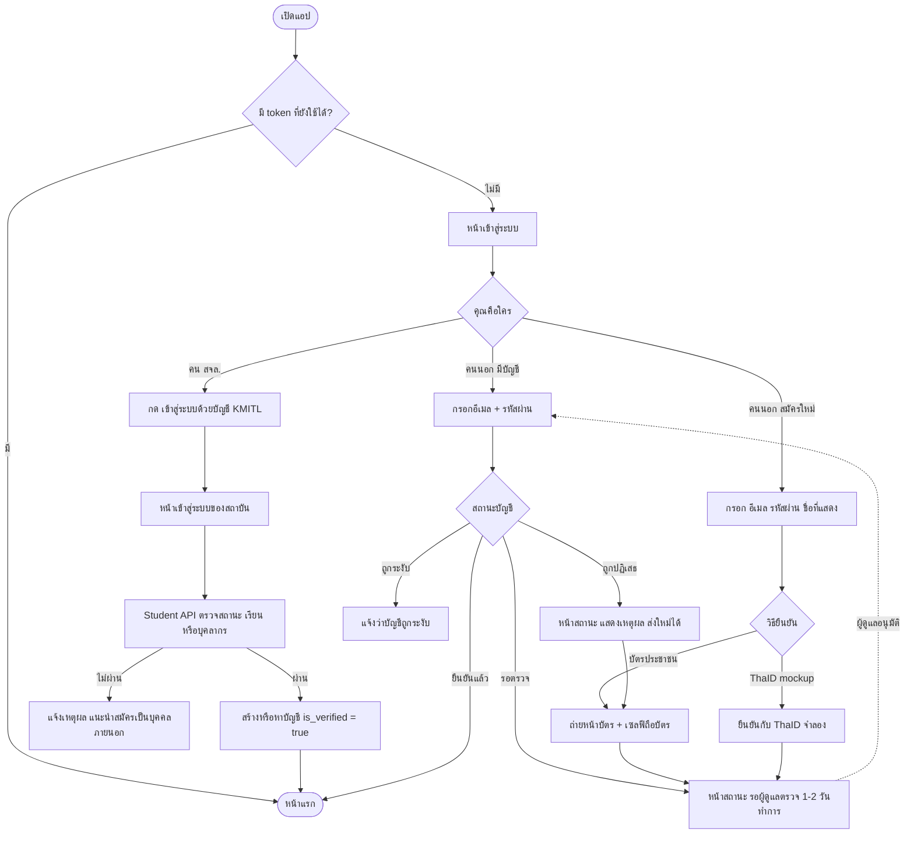
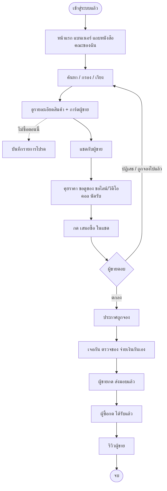
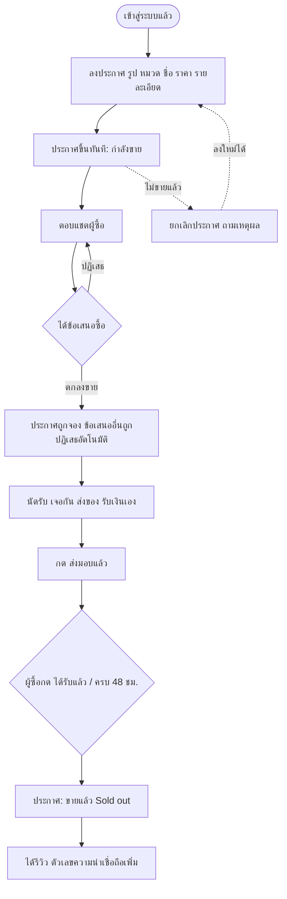
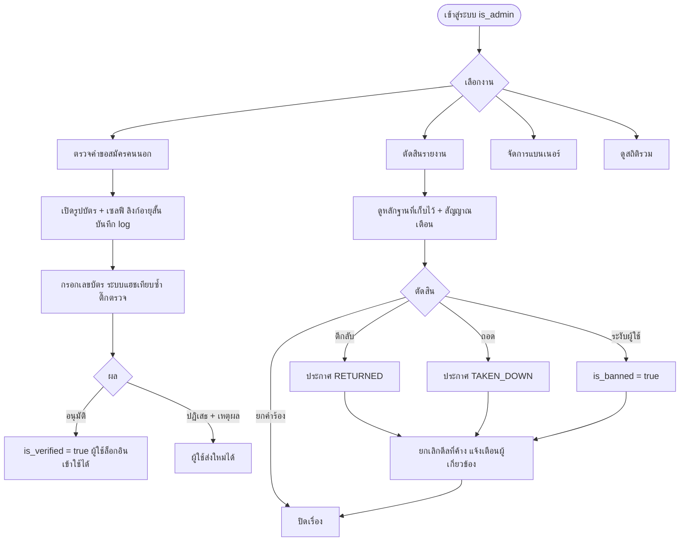
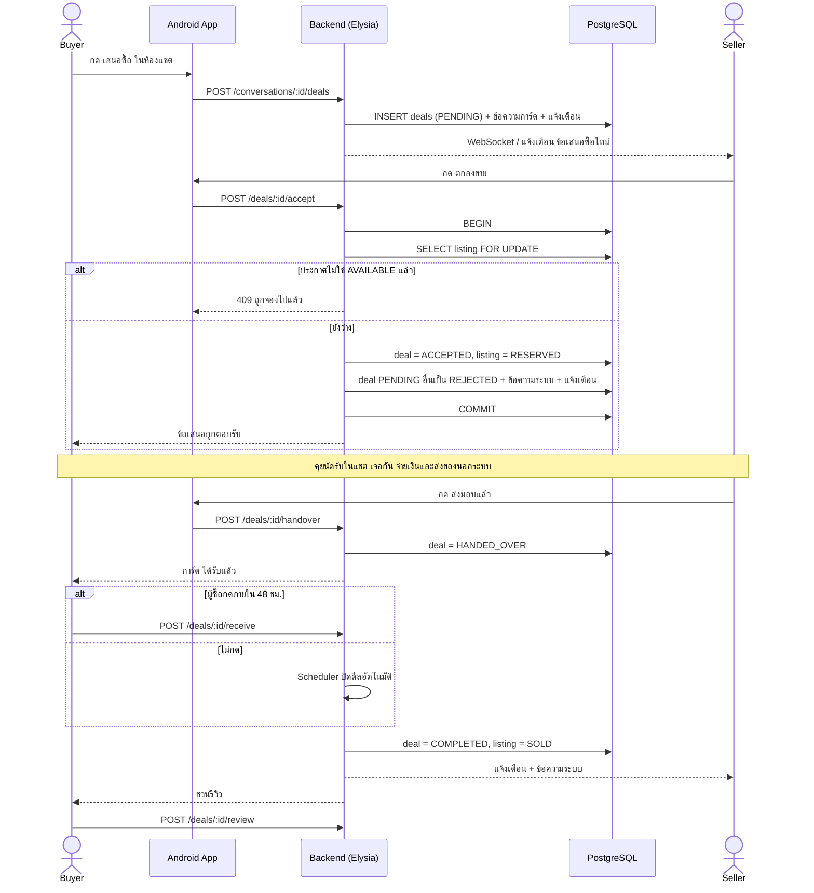
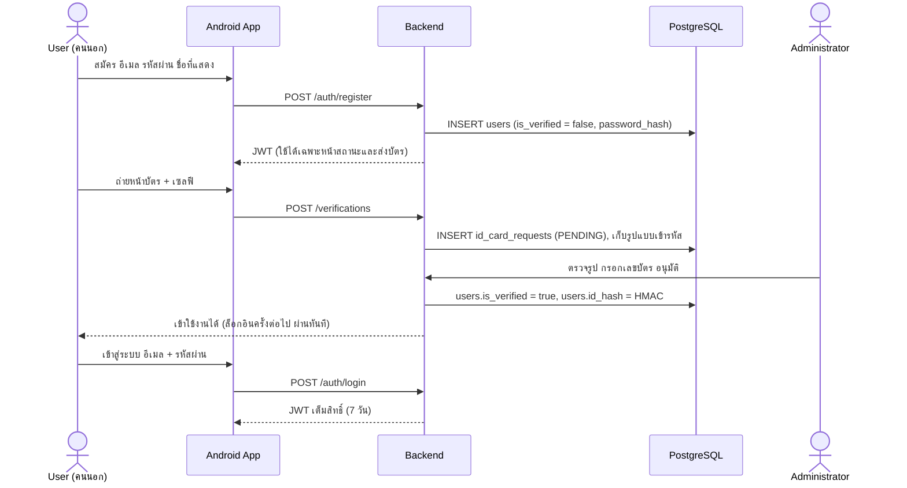
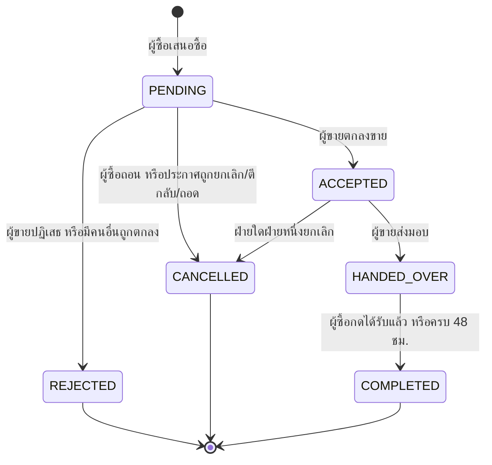
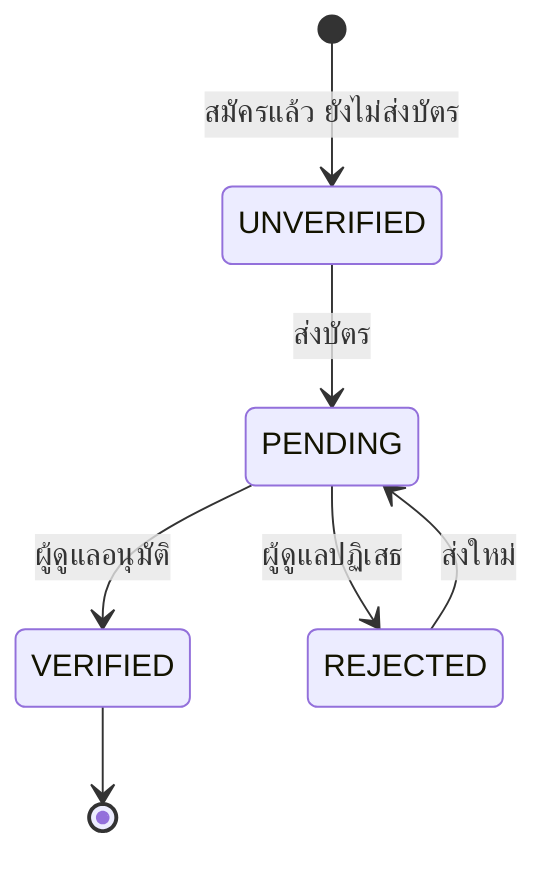

# Campus Market — Actor และ Workflow

> ฐานของ Use Case Diagram, Sequence Diagram และ State Diagram ในเอกสารส่งงาน
> อ้างอิง requirement CM/EX และกติกา BR ใน [PROJECT_PLAN.md](PROJECT_PLAN.md) · ตาราง/สถานะใน [DB_SCHEMA.md](DB_SCHEMA.md)

**หลักการเข้าใช้แอป (ตัดสินแล้ว):** ต้องล็อกอินและผ่านการยืนยันตัวตนก่อนถึงใช้แอปได้ ไม่มีโหมดผู้เยี่ยมชม · คน สจล. เข้าด้วยบัญชีสถาบัน (API ของสถาบัน) · คนนอกสมัครด้วยบัตรประชาชนแล้วล็อกอินด้วยอีเมลและรหัสผ่าน

---

## 1. Actor

| Actor | ชื่อทางการ | ความหมาย |
|---|---|---|
| ผู้ใช้ | **User** (abstract) | ทุกคนที่ใช้แอป ต้องล็อกอินแล้ว |
| ผู้ซื้อ | **Buyer** | User ที่กำลังหาซื้อสินค้า |
| ผู้ขาย | **Seller** | User ที่ลงประกาศขายสินค้า |
| ผู้ดูแลแพลตฟอร์ม | **Administrator** (Admin) | User ที่มีสิทธิ์ดูแลระบบ ตรวจตัวตน รายงาน โฆษณา |
| ระบบภายนอก | **KMITL SSO**, **Student API** | ยืนยันตัวตนคน สจล. |
| ระบบภายนอก | **ThaID** (mockup) | ยืนยันตัวตนคนนอก (ยังไม่เชื่อมจริง) |
| ตัวตั้งเวลา | **Scheduler** | งานเบื้องหลังของ server |

ชื่อ Actor ใช้ภาษาอังกฤษในเอกสารส่งงานเพื่อให้เป็นสากล

**ความสัมพันธ์ระหว่าง Actor (Generalization):**

```
                  User   (ล็อกอินและยืนยันตัวตนแล้วเท่านั้น)
        ┌───────────┼─────────────┐
      Buyer       Seller     Administrator
```

คนเดียวเป็นได้ทั้ง Buyer และ Seller (บัญชีเดียว) · Administrator คือ User ที่มี `is_admin` และยังซื้อขายได้เหมือน User ทั่วไป · ในฐานข้อมูลทั้งหมดคือตาราง `users` ตารางเดียว

**ไม่มี Guest:** ผู้ที่ยังไม่ล็อกอินทำได้แค่เข้าสู่ระบบหรือสมัครสมาชิก ซึ่งเป็น Use Case ของ User ที่กำลังจะผ่านการยืนยัน (ดูข้อ 3 และเหตุผลในข้อ 9)

---

## 2. Use Case

ทุก Use Case ยกเว้น UC03–UC05 และ UC28 ต้องล็อกอินและผ่านการยืนยันตัวตนแล้ว (BR01)

| รหัส | Use Case | Actor หลัก | Requirement |
|---|---|---|---|
| UC01 | ดูและค้นหาสินค้า (หมวด ราคา คณะ แท็ก ค้นข้อความ) | Buyer | CM03 |
| UC02 | ดูรายละเอียดสินค้าและโปรไฟล์ผู้ขาย | Buyer | CM02, CM08 |
| UC03 | เข้าสู่ระบบด้วยบัญชี KMITL (SSO) | User (คน สจล.) + KMITL SSO, Student API | CM01, EX01 |
| UC04 | สมัครสมาชิกคนนอกด้วยบัตรประชาชน | User (คนนอก) | CM01, EX01 |
| UC05 | สมัครสมาชิกคนนอกด้วย ThaID (mockup) | User (คนนอก) + ThaID | CM01, EX01 |
| UC28 | เข้าสู่ระบบด้วยอีเมลและรหัสผ่าน (คนนอก) | User (คนนอก) | CM01 |
| UC06 | บันทึก/เอาออกจากรายการโปรด | Buyer | CM04 |
| UC07 | แชตกับผู้ขาย / ผู้ซื้อ | Buyer, Seller | EX04, CM05 |
| UC08 | เสนอซื้อ | Buyer | CM05 |
| UC09 | ยืนยันได้รับสินค้า | Buyer | CM06 |
| UC10 | รีวิวผู้ขาย | Buyer | CM08 |
| UC11 | รายงานประกาศ / ผู้ใช้ / ข้อความ | Buyer, Seller | CM09 |
| UC12 | ดูและรับการแจ้งเตือน | Buyer, Seller | CM07 |
| UC13 | ดาวน์โหลดข้อมูลของฉัน / ลบบัญชี | User | EX03 |
| UC14 | ลงประกาศ | Seller | CM02 |
| UC15 | แก้ไข / ยกเลิก / ลงขายอีกครั้ง / ส่งใหม่หลังถูกตีกลับ | Seller | CM06 |
| UC16 | ตอบข้อเสนอซื้อ (ตกลงขาย / ปฏิเสธ) | Seller | CM05 |
| UC17 | ยืนยันส่งมอบสินค้า | Seller | CM06 |
| UC18 | ดู Dashboard ผู้ขาย | Seller | CM10 |
| UC19 | ตรวจคำขอสมัครของคนนอก (ตรวจบัตร) | Admin | EX01 |
| UC20 | ตัดสินรายงาน | Admin | CM09 |
| UC21 | ตีกลับ / ถอด / กู้คืนประกาศ | Admin | CM09 |
| UC22 | ระงับ / ปลดระงับผู้ใช้ | Admin | CM09 |
| UC23 | จัดการแบนเนอร์โฆษณา | Admin | EX02 |
| UC24 | ดูสถิติรวมของแพลตฟอร์ม | Admin | CM10 |
| UC25 | ปิดดีลอัตโนมัติเมื่อผู้ซื้อไม่ยืนยันใน 48 ชม. | Scheduler | BR11 |
| UC26 | เตือนช่วยปิดดีล / ชวนรีวิว | Scheduler | CM07 |
| UC27 | ลบรูปบัตร (7 วัน) และไฟล์ log (90 วัน) | Scheduler | BR19, BR20 |

ความสัมพันธ์ `<<include>>`: UC03 รวมการเรียก Student API · UC04 และ UC05 ตามด้วย UC19 (ผู้ดูแลตรวจ) เฉพาะบัตร · UC07, UC08, UC10, UC11, UC14 รวม "ล็อกอินและยืนยันตัวตนแล้ว" (BR01)

---

## 3. Workflow: การเข้าใช้แอป (ทุก Actor ต้องผ่านก่อน)



**หลักการ**

- คนที่ยังไม่ผ่านการยืนยัน **ล็อกอินได้แต่เห็นเฉพาะหน้าสถานะ** (รอตรวจ / ถูกปฏิเสธ / ถูกระงับ) ใช้ฟีเจอร์อื่นไม่ได้
- คน สจล. ผ่านทันทีหลัง SSO สำเร็จและ Student API ยืนยันสถานะ ไม่ต้องรอใคร
- สมัครคนนอกต้องสร้างบัญชี (อีเมล + รหัสผ่าน) ก่อนส่งบัตร จะได้ล็อกอินกลับมาดูผลได้
- ThaID เป็น mockup ผ่านทันทีในโหมดพัฒนา ส่วนบัตรต้องรอผู้ดูแล (Workflow ของ Admin ข้อ 2)
- เก็บอีเมลเฉพาะคนนอก (เป็นชื่อล็อกอิน) ไม่ได้ยืนยันความเป็นเจ้าของอีเมลและไม่มีระบบรีเซ็ตรหัสผ่านทางอีเมล (ต้องมีระบบส่งอีเมล) ลืมรหัสผ่านให้ติดต่อผู้ดูแล

---

## 4. Workflow: Buyer

**เป้าหมาย:** หาสินค้าที่ต้องการ คุยกับผู้ขาย ซื้อ และรู้ว่าผู้ขายน่าเชื่อถือไหม



**ขั้นตอนหลัก**

1. **เข้าสู่ระบบ** (ข้อ 3)
2. **ดูและค้นหา** หน้าแรกมีแบนเนอร์โฆษณา ชิปหมวด แถบหนังสือสำหรับคณะของตัวเอง ค้นด้วยคำ (ชื่อ รหัสวิชา ยี่ห้อ) กรองด้วยหมวด ราคา คณะ แท็ก
3. **ดูรายละเอียด** รูป รายละเอียดที่ผู้ขายเขียน แท็ก และการ์ดผู้ขาย (คะแนน ปิดการขายสำเร็จ อัตราปิดการขาย)
4. **แชต** ถามเพิ่ม ต่อรองราคา ขอดูของผ่านวิดีโอคอลทางไลน์ (แลกไลน์กันเอง) ตกลงที่และเวลานัดรับ
5. **เสนอซื้อ** กดปุ่มในห้องแชต ได้การ์ดข้อเสนอ สถานะ "รอผู้ขายตอบ"
6. **รอผลตอบ** แจ้งเตือนเมื่อผู้ขายตกลงหรือปฏิเสธ ตกลง → ประกาศเป็น "ถูกจอง" เฉพาะผู้ซื้อคนนี้
7. **เจอกันและจ่ายเงิน** นอกระบบ (ระบบไม่เกี่ยวกับเงิน)
8. **ยืนยันรับของ** หลังผู้ขายกด "ส่งมอบแล้ว" ผู้ซื้อกด "ได้รับแล้ว" ในการ์ด (ไม่กดภายใน 48 ชม. ระบบปิดดีลให้)
9. **รีวิวผู้ขาย** 1–5 ดาว + ข้อความ (ได้เฉพาะดีลที่สำเร็จ ดีลละครั้ง)

**ทางเลือกและกรณีผิดปกติ**

| กรณี | เกิดอะไร |
|---|---|
| มีคนตกลงซื้อตัดหน้า | ผู้ซื้อได้ "ประกาศนี้ถูกจองไปแล้ว" (409) เสนอซื้อไม่ได้ ไปหาประกาศอื่น |
| เปลี่ยนใจ | ถอนข้อเสนอที่รอตอบ · ถ้าผู้ขายตกลงแล้ว ยกเลิกดีลได้ ประกาศกลับเป็น "กำลังขาย" |
| ไม่ได้รับของ / สงสัยหลอกลวง | รายงานประกาศ ผู้ใช้ หรือข้อความ (ส่งต่อไป Workflow ของ Admin) |
| ไม่มีเน็ต | ดูของที่เคยโหลดได้ พิมพ์ข้อความได้ (ส่งทีหลัง) เสนอซื้อ/รีวิว/รายงานไม่ได้ |
| ลืมกดได้รับแล้ว | ระบบเตือนหลัง 24 ชม. และปิดดีลให้ที่ 48 ชม. |
| token หมดอายุ (7 วัน) หรือถูกระงับ | กลับหน้าเข้าสู่ระบบ / หน้าแจ้งสถานะ |

---

## 5. Workflow: Seller

**เป้าหมาย:** ลงขายให้ง่าย ปิดการขายสำเร็จในระบบ และสะสมความน่าเชื่อถือ



**ขั้นตอนหลัก**

1. **เข้าสู่ระบบ** (ข้อ 3)
2. **ลงประกาศ** ถ่ายหรือเลือกรูป 1–5 รูป เลือกหมวด (หนังสือ: เลือกหมวดดิวอี้ + คณะที่ใช้) กรอกชื่อ ราคา รายละเอียด (สภาพ ตำหนิ สเปก รหัสวิชา เงื่อนไขต่อรองเขียนเอง) เลือกแท็ก · ไม่มีเน็ตบันทึกเป็นแบบร่างแล้วลงทีหลัง · ประกาศขึ้นทันทีไม่ต้องรออนุมัติ
3. **ตอบแชต** ผู้ซื้อทักเข้ามา ได้แจ้งเตือนข้อความใหม่
4. **ตอบข้อเสนอซื้อ** กดตกลงขาย หรือปฏิเสธ · ตกลงแล้วประกาศเป็น "ถูกจอง" และข้อเสนออื่นถูกปฏิเสธอัตโนมัติ (ตรวจที่ server กันจองซ้อน)
5. **นัดรับและส่งมอบ** คุยที่/เวลาในแชต (ข้อความธรรมดา) เจอกันส่งของ รับเงินเอง แล้วกด "ส่งมอบแล้ว"
6. **ผู้ซื้อยืนยัน** ดีลสำเร็จ ประกาศเป็น "ขายแล้ว" แจ้งเตือนผู้ขาย
7. **ดูผลลัพธ์** รีวิวที่ได้ · ปิดการขายสำเร็จ · อัตราปิดการขาย · Dashboard ยอดขายรายเดือน (ตามราคาประกาศ)

**จัดการประกาศ** (หน้า "ประกาศของฉัน")

| สถานะ | ผู้ขายทำได้ |
|---|---|
| กำลังขาย | แก้ไข · ยกเลิก (ถามเหตุผล: ขายได้แล้วที่อื่น / เปลี่ยนใจ / ของเสีย) |
| ถูกจอง | ดูดีล · ยกเลิกดีล · ส่งมอบ (ยกเลิกประกาศตรง ๆ ไม่ได้) |
| ขายแล้ว | ดูอย่างเดียว (สถานะสุดท้าย) |
| ยกเลิกแล้ว | ลงขายอีกครั้ง |
| ถูกตีกลับ | อ่านเหตุผลจากผู้ดูแล แก้ไขแล้วส่งใหม่ (กลับเป็นกำลังขายทันที) |
| ถูกถอด | ดูเหตุผล ติดต่อผู้ดูแลถ้าไม่เห็นด้วย (กู้คืนโดยผู้ดูแลเท่านั้น) |

**กรณีผิดปกติ**

| กรณี | เกิดอะไร |
|---|---|
| ตกลงขายคนละคนพร้อมกันจากสองเครื่อง | สำเร็จได้รายการเดียว อีกรายการได้ 409 |
| ขายนอกระบบไปแล้ว | ผู้ขายกด "ขายแล้ว" เองไม่ได้ ต้องยกเลิกประกาศ (ระบบถามเหตุผล) ไม่ได้ตัวเลขปิดการขาย |
| ผู้ซื้อไม่มาตามนัด | ยกเลิกดีล ประกาศกลับเป็น "กำลังขาย" |
| ถูกรายงาน | ผู้ดูแลตรวจ อาจถูกตีกลับ/ถอด/ระงับบัญชี (ได้แจ้งเตือนพร้อมเหตุผล) |
| บัญชีถูกระงับ | ใช้งานไม่ได้ทันที ประกาศถูกซ่อนจากการค้นหา (ไม่เปลี่ยนสถานะ ปลดแล้วกลับมาเอง) |

---

## 6. Workflow: Administrator

**เป้าหมาย:** ดูแลความถูกต้องของตัวตน ความปลอดภัยของผู้ใช้ และโฆษณา โดยมีบันทึกการกระทำทุกครั้ง



**ขั้นตอนหลัก**

1. **เข้าสู่ระบบ** เหมือน User ทั่วไป (ข้อ 3) แต่มี `is_admin` เมนูผู้ดูแลโผล่ในแท็บ "ฉัน" (ตั้งค่าที่ฐานข้อมูลโดยตรง ไม่มีหน้าสมัครผู้ดูแลในแอป)
2. **ตรวจคำขอสมัครของคนนอก** (UC19) คิวคำขอ `PENDING` → เปิดรูปผ่านลิงก์อายุสั้น (ห้ามบันทึกหน้าจอ และระบบเขียน log ทุกครั้ง) → กรอกเลขบัตร (ระบบเก็บเฉพาะค่าแฮชกัน 1 คนหลายบัญชี) → ติ๊ก: เซลฟีตรงกับบัตร, อายุ 20+ → อนุมัติหรือปฏิเสธพร้อมเหตุผล · รูปถูกลบอัตโนมัติ 7 วันหลังตัดสิน
3. **ตัดสินรายงาน** (UC20–22) คิวรายงาน `OPEN` → ดูสำเนาหลักฐาน ณ เวลารายงาน (ประกาศ หรือข้อความ + 5 ข้อความรอบข้าง) และสัญญาณ (จำนวนผู้รายงาน อายุบัญชี มีรีวิวไหม) → เลือก: **ยกคำร้อง** / **ตีกลับ** (ผู้ขายแก้ได้) / **ถอด** (ร้ายแรง) / **ระงับผู้ใช้** → ใส่หมายเหตุ (บังคับ) → ปิดเรื่อง · ผู้ที่เกี่ยวข้องได้แจ้งเตือน ดีลที่ค้างถูกยกเลิก
4. **จัดการแบนเนอร์** (UC23) เพิ่ม แก้ เปิด/ปิด เรียงลำดับ กำหนดช่วงวัน ใส่ลิงก์ `https://` หรือลิงก์ประกาศในแอป
5. **ดูสถิติรวม** (UC24) ผู้ใช้ ประกาศ ดีลที่สำเร็จ รายงานที่ค้าง หมวดยอดนิยม
6. **งานตามคำร้อง** กู้คืนประกาศที่ถูกถอดเมื่อผู้ขายอุทธรณ์ · ตอบคำร้องแก้ไข/คัดค้านข้อมูลส่วนบุคคลภายใน 30 วัน (BR21) · ช่วยผู้ใช้คนนอกที่ลืมรหัสผ่าน
7. ผู้ดูแล **ซื้อขายได้เหมือน User ทั่วไป** ในบัญชีเดียว

**ข้อจำกัดของผู้ดูแล** (ป้องกันใช้อำนาจเกิน)

| กฎ | เหตุผล |
|---|---|
| ตัดสินรายงานเรื่องของตัวเองไม่ได้ · ระงับตัวเองหรือผู้ดูแลคนอื่นไม่ได้ | กันขัดผลประโยชน์ |
| ทุกการตัดสินต้องมีหมายเหตุ | ตรวจย้อนได้ |
| เห็นข้อความแชตเฉพาะที่ถูกรายงาน | ความเป็นส่วนตัวของผู้ใช้ (BR26) |
| เปิดรูปบัตรได้เฉพาะผ่านลิงก์อายุสั้นและมี log | PDPA ม.37 |

---

## 7. Workflow ของระบบ (Scheduler)

| งาน | ความถี่ | ผลลัพธ์ |
|---|---|---|
| ปิดดีลอัตโนมัติ | ทุก 15 นาที | ดีล "ส่งมอบแล้ว" เกิน 48 ชม. ปิดเป็นสำเร็จ (ข้ามดีลที่มีรายงานค้าง) |
| เตือนช่วยปิดดีล | ทุก 15 นาที | ตกลงแล้วเกิน 24 ชม. → เตือนทั้งสองฝ่าย · ส่งมอบแล้วเกิน 24 ชม. → เตือนผู้ซื้อ · สำเร็จแล้ว → ชวนรีวิว และเตือนซ้ำหลัง 3 วัน (ส่งครั้งเดียวต่อดีล) |
| ลบรูปบัตร/เซลฟี | วันละครั้ง | ครบ 7 วันหลังตัดสิน |
| ลบไฟล์ log | วันละครั้ง | เกิน 90 วัน |

---

## 8. Sequence Diagram และ State Diagram

### 8.1 ซื้อขายผ่านการ์ดในแชต (เส้นทางหลัก)



### 8.2 เข้าสู่ระบบของคนนอก (อีเมล + รหัสผ่าน)



### 8.3 State ของดีล



### 8.3 State ของการยืนยันตัวตนคนนอก



สถานะของประกาศ (6 สถานะ) ดูข้อ 2.10 ใน [PROJECT_PLAN.md](PROJECT_PLAN.md) · คน สจล. ข้ามสถานะนี้ (ผ่านเป็น VERIFIED ทันทีหลัง SSO)

---

## 9. ตัดสินใจแล้ว และเหตุผลเรื่อง Guest

**ตัดสินแล้ว**

- ชื่อ Actor ภาษาอังกฤษ: Buyer / Seller / Administrator (เป็นสากล)
- Scheduler เป็น Actor ในไดอะแกรม
- ต้องล็อกอินและผ่านการยืนยันตัวตนก่อนใช้แอป · คนนอกล็อกอินด้วยอีเมล + รหัสผ่าน

**ทำไมไม่มี Guest (ใช้เป็นค่าเริ่มต้น)** เทียบสองทาง:

| | **ไม่มี Guest** (ใช้อยู่) | Guest ดูและค้นหาได้ แต่แชต/เสนอซื้อ/รายการโปรดต้องล็อกอิน |
|---|---|---|
| ความซับซ้อน | ต่ำ ทุก endpoint ต้องมี JWT และผ่านการยืนยันเท่านั้น | สูงขึ้น: endpoint อ่านต้องรองรับทั้งมีและไม่มี token, ต้องจำกัดอัตราของคนที่ไม่ล็อกอิน, ต้องมีหน้าชวนล็อกอินเมื่อกดปุ่มที่ต้องใช้สิทธิ์ |
| ความเป็นส่วนตัวและความปลอดภัย | ประกาศ ชื่อผู้ขาย รูป เห็นเฉพาะสมาชิกที่ยืนยันแล้ว ลดการเก็บข้อมูลหรือสำรวจเหยื่อโดยคนนอก | ข้อมูลสาธารณะ ใครก็ดึงได้ (ไม่มีข้อมูลส่วนตัวอื่นนอกจากชื่อที่แสดงและคณะ) |
| เหมาะกับชุมชน | ตรงกับ "ตลาดภายในมหาวิทยาลัย" และข้อกำหนดยืนยันตัวตน | เหมาะกับตลาดเปิด |
| ผู้ใช้ใหม่ | เห็นเฉพาะหน้าเข้าสู่ระบบ/สมัคร · คนนอกที่รอตรวจ 1–2 วันเห็นแค่หน้าสถานะ | ดูของก่อนตัดสินใจสมัครได้ ลดการหลุดระหว่างรอตรวจ |
| โฆษณา | เข้าถึงเฉพาะสมาชิก ซึ่งเป็นกลุ่มเป้าหมายอยู่แล้ว | เห็นโดยคนนอกด้วย แต่ไม่ได้นับยอดอยู่ |
| แชร์ลิงก์ประกาศ | เปิดแล้วต้องล็อกอินก่อน | เปิดดูได้เลย |

เหตุผลที่เลือก "ไม่มี Guest": เรื่องใหญ่ที่แลกคือผู้ใช้ใหม่เห็นสินค้าก่อนสมัครไม่ได้ ซึ่งสำหรับตลาดปิดภายในสถาบันกระทบน้อย ส่วนที่ได้คือความเรียบง่ายและความเป็นส่วนตัว **เปลี่ยนเป็นแบบมี Guest ได้ภายหลังโดยไม่แก้ฐานข้อมูล** ทำแค่ให้ `GET /listings` กับ `GET /banners` อ่านได้โดยไม่ต้องมี token แล้วเพิ่มหน้าชวนล็อกอิน
